
 

[&color=rgb(147%2C228%2C234))](https://github.com/EmirErtorer/CyberUI.koplugin/releases/latest)
[&color=rgb(147%2C228%2C234))](https://github.com/EmirErtorer/CyberUI.koplugin/releases)
[&color=rgb(147%2C228%2C234))](CHANGELOG.md)
[&color=rgb(147%2C228%2C234))](https://buymeacoffee.com/emirertorer)

CyberUI is a **cyberpunk home screen** for KOReader, built to be fast on e-ink.

* **A home that feels like a deck**: the book you are reading, your recent books, your streak and a launcher, with a status bar of live readouts.
* **A library you can work in**: folders, ASCII covers, search, collections, a reading log and a trash, with rename, move and delete that take your reading data along.
* **Your look**: seven colour schemes and your own, fourteen cyberpunk font sets, ASCII covers and sleep screens, and KOReader's own menu restyled to match.

Home comes back the moment you close a book, in a single screen refresh.

## At a glance

<table>
  <tr>
    <td width="33%" valign="top"><a href="assets/screenshots/01-home.png">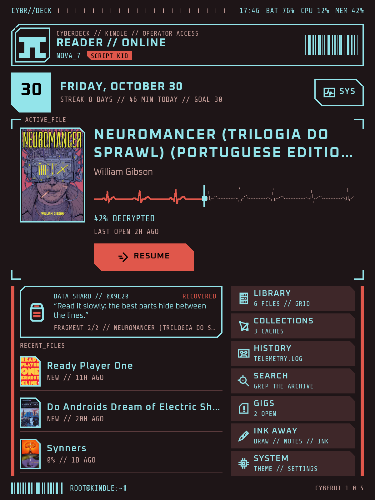</a> Home: the book you are reading with Resume, recent books and a launcher, in Neon.</td>
    <td width="33%" valign="top"><a href="assets/screenshots/02-library.png">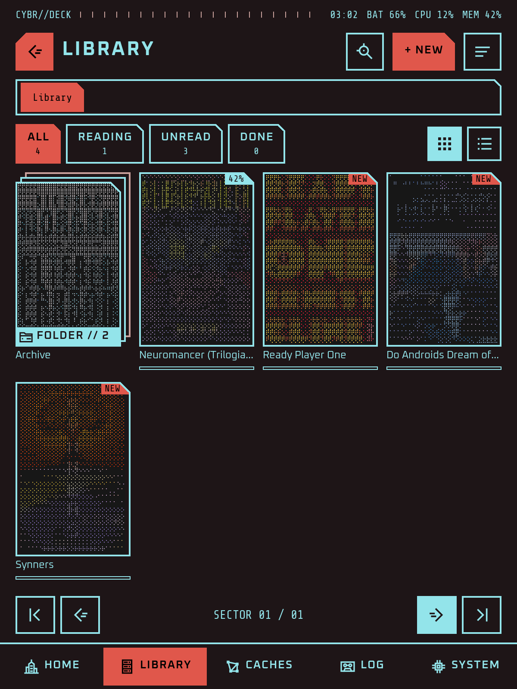</a> The library: ASCII covers, folders stacked under their first book, filters and sort.</td>
    <td width="33%" valign="top"><a href="assets/screenshots/03-menu.png">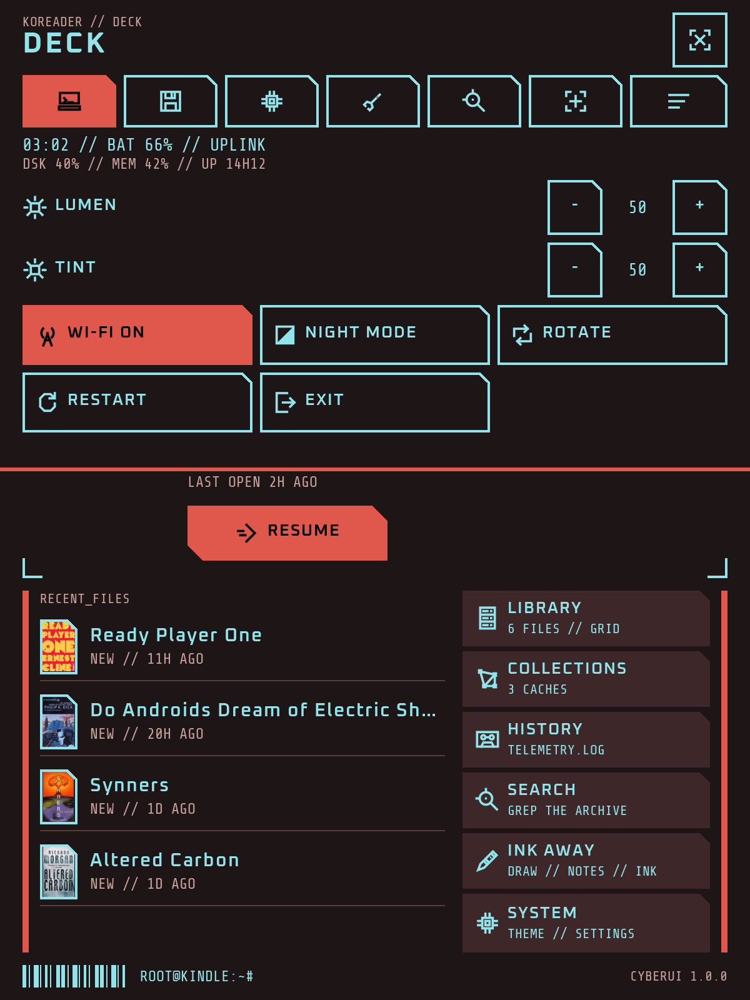</a> KOReader's own menu, restyled: every setting and plugin, with the Deck tab first.</td>
  </tr>
</table>

## Screenshots

<table>
  <tr>
    <td width="33%" valign="top"><a href="assets/screenshots/04-details.png">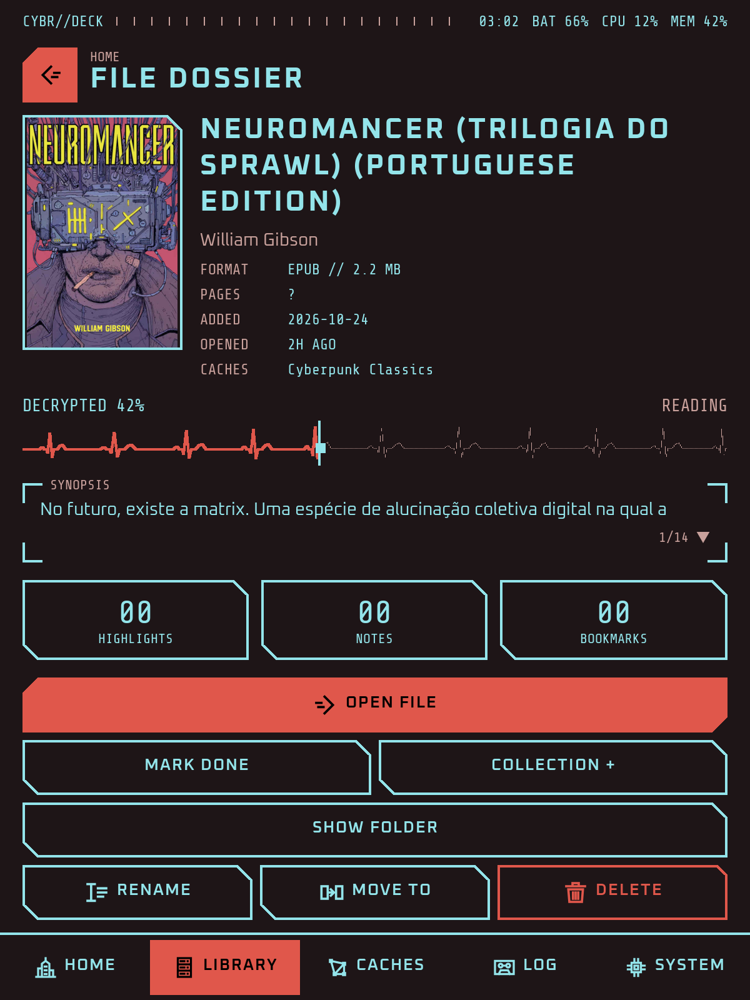</a> A book's details: facts, progress, a paged synopsis, and every action in reach.</td>
    <td width="33%" valign="top"><a href="assets/screenshots/05-search.png">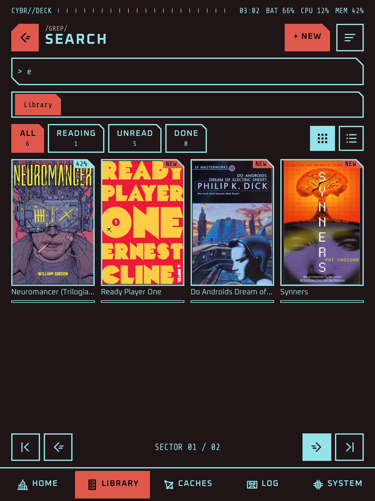</a> Search as you type with CyberUI's own keyboard.</td>
    <td width="33%" valign="top"><a href="assets/screenshots/06-collections.png">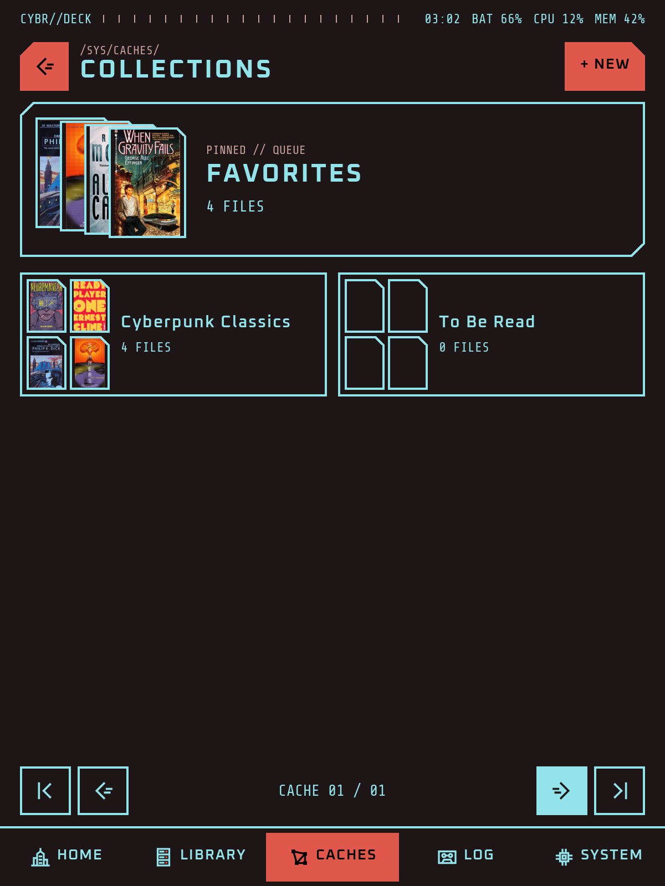</a> Collections, each a fan of its books.</td>
  </tr>
  <tr>
    <td width="33%" valign="top"><a href="assets/screenshots/07-log.png">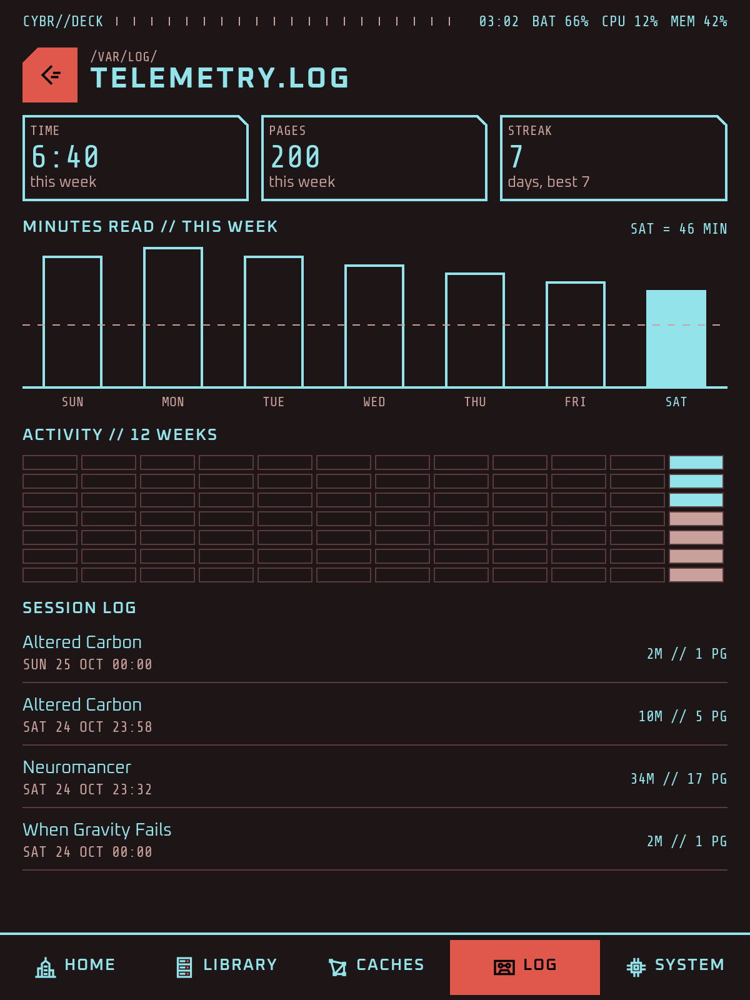</a> The reading log: your week, your streak and each session.</td>
    <td width="33%" valign="top"><a href="assets/screenshots/08-diagnostics.png">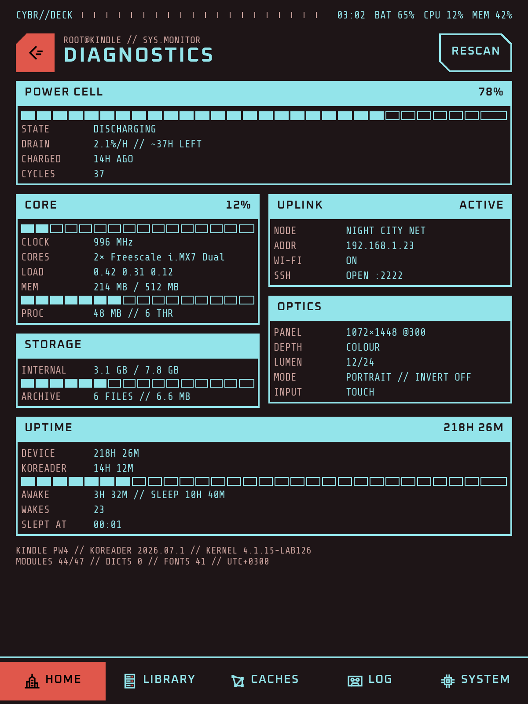</a> Diagnostics: battery, processor, memory, storage, Wi-Fi, screen and uptime.</td>
    <td width="33%" valign="top"><a href="assets/screenshots/09-look.png">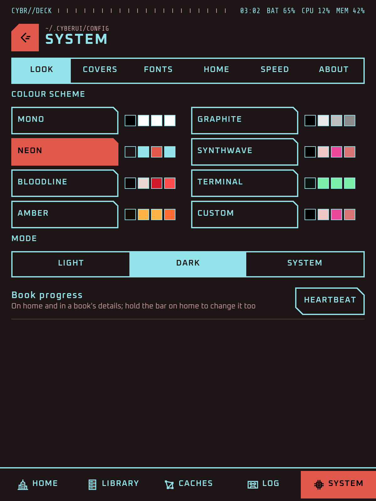</a> Seven colour schemes and your own, in light and dark.</td>
  </tr>
  <tr>
    <td width="33%" valign="top"><a href="assets/screenshots/10-covers.png">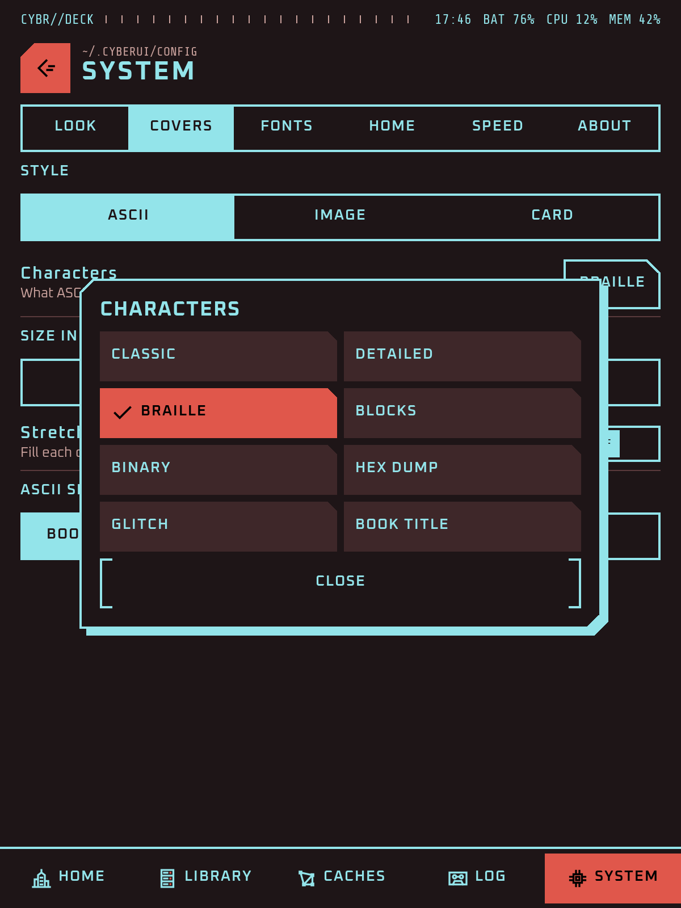</a> Covers as ASCII art in eight character sets, as pictures or as title cards.</td>
    <td width="33%" valign="top"><a href="assets/screenshots/11-sleep.png">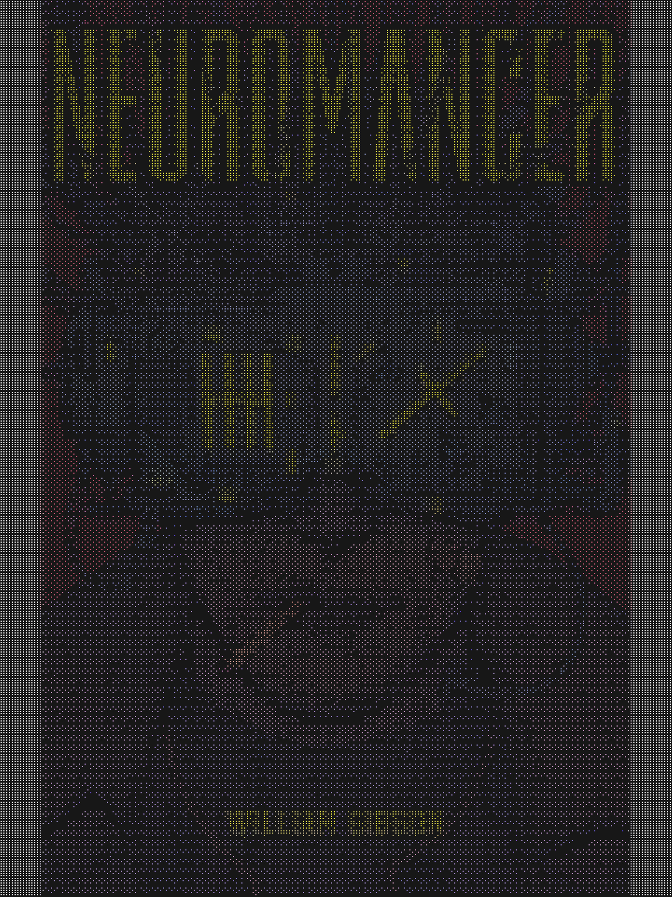</a> The sleep screen in ASCII: your book's cover, a picture, or anything KOReader shows.</td>
    <td width="33%" valign="top"><a href="assets/screenshots/12-landscape.png">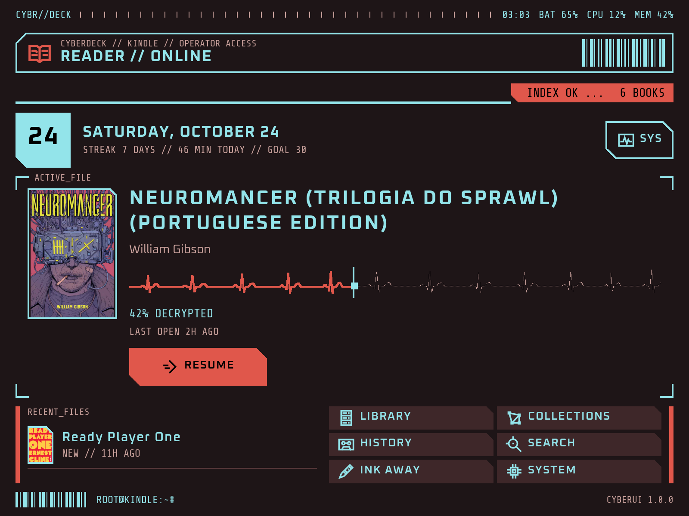</a> Every screen works in landscape too.</td>
  </tr>
</table>

## Features

### Home

| | |
|---|---|
| **Active file** | The book you are reading, with its cover, progress and Resume. Tap a recent book to bring it here; open it from the panel. |
| **Back from a book** | Home shows first and KOReader closes the book behind it, so coming home is one quick refresh. KOReader's own Home action takes the same way while CyberUI is your home, and the "CyberUI home" action goes on any gesture. |
| **Banner** | A set line, a greeting with your handle, a random highlight from your books, the device's status or your own words, with a top line of its own. Hold it to change it. |
| **Status bar** | Your tag, then up to six readouts in the order you choose: clock, date, battery, Wi-Fi, frontlight, processor, memory, storage, book progress, uptime. |
| **Progress** | Segments, an ASCII bar, a heartbeat trace, a scan line or an equalizer, each marking exactly where you are. Hold the bar to switch. |
| **Diagnostics** | Battery and drain, processor and memory, storage, Wi-Fi, screen and light, uptime and the device at a glance, behind the SYS button. |

### Library

| | |
|---|---|
| **Browse** | Folders with breadcrumbs, a grid or a list, sort by recent, title, author or added, and filters for reading, unread and done. Folders show as a stack under their first book's cover. |
| **Book actions** | Hold a book or folder to open, see details, mark it done, add it to collections, rename, move or delete it. Rename and move keep its reading data, history and collections. |
| **Trash** | Deleted books and folders wait 30 days and go back exactly where they were. |
| **Details** | Facts, progress, a synopsis that pages, and highlight, note and bookmark counts. |
| **Search** | Titles, authors and file names as you type, on CyberUI's own keyboard. |
| **Collections and log** | KOReader's collections as fans of covers, and your reading log by day and session. |

### Look

| | |
|---|---|
| **Colour schemes** | Mono, Graphite, Neon, Synthwave, Bloodline, Terminal and Amber, or your own two colours, each in light and dark and following KOReader's night mode. Greyscale screens get the grey ones. |
| **Fonts** | Fourteen sets, from Oxanium (the default) and Orbitron to the VT323 terminal and Press Start 2P arcade, or any font installed on your reader, with a text size of your own. |
| **ASCII covers** | Covers drawn as character art, in colour on colour screens, in Braille, Classic, Detailed, Blocks, Binary, Hex, Glitch or your book's own title. Image covers and title cards too, in four sizes. |
| **ASCII sleep screen** | KOReader's sleep screen redrawn in ASCII: book covers by default, or custom images, or everything. Transparent pictures let your book or home show through, and KOReader's message stays crisp. |
| **Icons** | A set of its own, drawn for CyberUI, with small lights in your accent colour. |

### KOReader's menu

| | |
|---|---|
| **Restyled** | The drop-down menu over home and inside books, in CyberUI's style, read live from KOReader so every setting and every plugin's entry is there. It drops from the top and takes up to half the screen. |
| **Deck** | Frontlight and warmth, Wi-Fi, night mode, rotate, restart and exit, with the device at a glance. |
| **With ZenOS** | When ZenOS is running, its Controls and Launcher show as CyberUI tiles instead of the Deck. |

### Speed and e-ink

| | |
|---|---|
| **Fast** | Home paints in a few milliseconds, covers are drawn once and cached, and the reader's code loads while home sits idle, so even your first book opens quicker. |
| **Refreshes** | Only what changed is redrawn. Values that keep changing never refresh the screen by themselves, and dark screens get the cleaner refreshes they need. |

### Companions and updates

| | |
|---|---|
| **Ink Away** | On the launcher: it opens when installed, and otherwise installs from GitHub in one tap. |
| **Updates** | System, About, Updates shows the newest release (and prereleases, if you want them) with its notes, and installs it after checking the download. Once a day, only on Wi-Fi that is already on, it looks by itself and says so on home. |

## Installation

Unzip the download and copy the `CyberUI.koplugin` folder inside it into KOReader's `plugins` directory:

- Kindle: `koreader/plugins/CyberUI.koplugin/`
- Kobo: `.adds/koreader/plugins/CyberUI.koplugin/`
- Android: `koreader/plugins/CyberUI.koplugin/` in app storage

Then restart KOReader and open the top menu, the first tab (the file browser's), **Start with**, **CyberUI**. From then on CyberUI updates itself: System, About, Updates.

What changed in each version is in the [changelog](CHANGELOG.md).

<b>Getting started</b>

1. **Make it your start screen** in the top menu's first tab, Start with, CyberUI, or in CyberUI's System, Home, Start with CyberUI.
2. **Open a book** from Resume, a recent book, or the library. Close it and you are back home.
3. **Want a gesture home?** Open a book first, then Settings, Taps and gestures, Gesture manager, and pick "CyberUI home" under General. A book has its own gestures, apart from the file browser's.
4. **Swipe down from the top** for KOReader's menu in CyberUI's style.
5. **Hold things.** Books, folders, the banner and the progress bar all have more on a long press.
6. **Make it yours** in System: colour scheme, fonts, covers, the banner and the status bar.

## Notes

- Tested on KOReader 2026.07.1 and newer, on a Kindle Paperwhite, a Kindle Scribe and an Android tablet.
- CyberUI only reads your library to show it. It changes files only when you rename, move or delete something, and deleted things wait in its trash for 30 days.
- ASCII covers use the cover pictures KOReader already keeps, so a new book shows a title card until KOReader has read its cover.

## About

I design CyberUI and test it on my Kindle Paperwhite. It is built around what e-readers can do: slow processors and screens that redraw slowly, so every screen paints in milliseconds and nothing redraws more than it needs to. Every change runs against CyberUI's checks on KOReader's own drawing code and in the emulator, and anything I can't test there goes out as a prerelease first.

## Contributing

Bug reports, testing prereleases on your reader, colour schemes, ideas and pull requests are all welcome. [CONTRIBUTING.md](CONTRIBUTING.md) explains how to get started, and [SECURITY.md](SECURITY.md) how to report a security problem.

## License

MIT (see [`LICENSE`](LICENSE)). The bundled fonts are under the SIL Open Font License; see [NOTICE.md](NOTICE.md).
