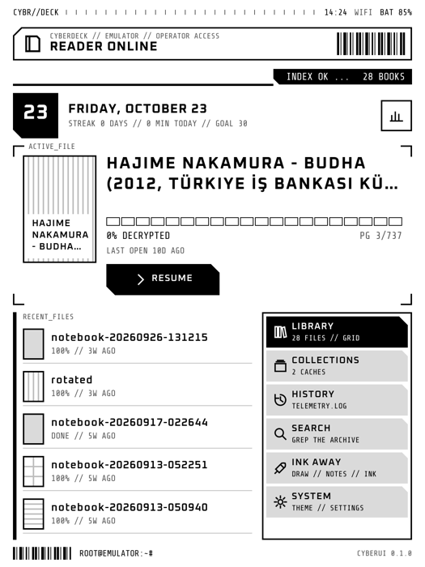
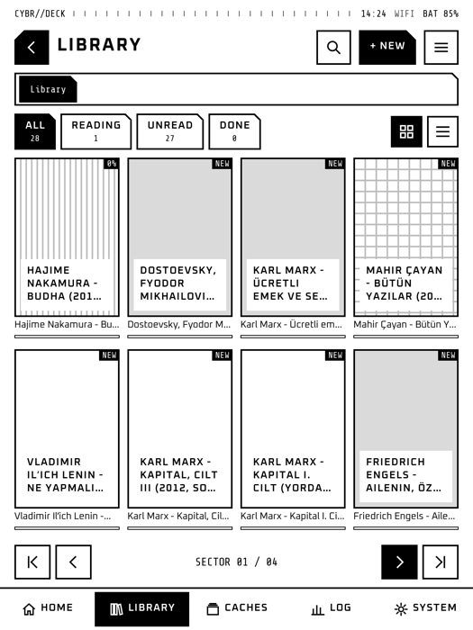
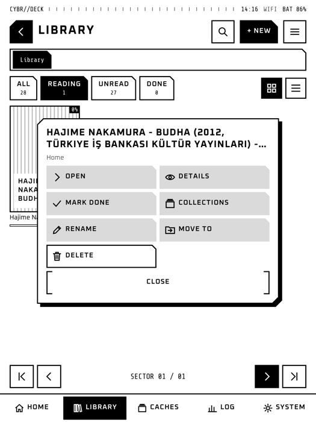
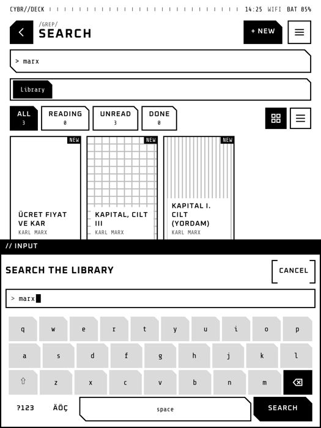
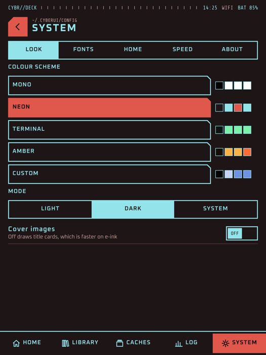
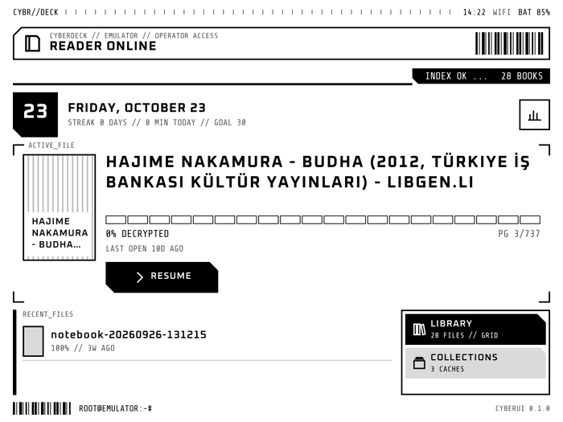

# CyberUI

A fast, cyberpunk-styled home screen for [KOReader](https://github.com/koreader/koreader).
CyberUI replaces the file browser as the first thing you see: the book you are reading with
a Resume button, your recent books, a library browser, collections, a reading log and
settings, all drawn in one consistent "cyberdeck" look that switches between light, dark
and colour themes.

<p>



</p>
<p>



</p>

## Features

- **Home**: today's date and reading streak, the current book with its progress and a
  Resume button, recent books, and a launcher for every section, Ink Away included.
- **Library explorer**: your folders and books as a paged grid or list, with Reading, Unread
  and Done filters and four sort orders. Folders open in place with a breadcrumb bar to go
  back up. Tap a book to read it; hold a book or folder for its actions (details, mark done,
  collections, rename, move to another folder, delete). **+ New** makes folders.
- **Trash**: deleted books and folders wait 30 days with their reading data, and go back
  where they were, into their collections and history, with one tap.
- **Dossier**: everything about one book (format, size, pages, collections, synopsis,
  highlight and note counts) and every action on it: open, mark done or reading, add to
  collections, show its folder, delete.
- **Collections**: Favorites pinned on top, every other collection as a card with its covers,
  and new collections in one tap.
- **Search**: finds books by title, author, series or file name across the whole library,
  with results that follow your typing.
- **Keyboard**: CyberUI's own on-screen keyboard for every text it asks for, with number and
  accented-letter layers.
- **Reading log**: time and pages this week, the streak, minutes per day against your daily
  goal, twelve weeks of activity and the latest sessions (from KOReader's statistics).
- **Themes**: Mono, Neon, Terminal, Amber and a Custom scheme with your own accent colours,
  each in Light, Dark or System mode (System follows KOReader's night mode). Switching is
  instant, with no restart.
- **Fonts**: Oxanium by default, or Chakra Petch, Tomorrow, Rajdhani or KOReader's own
  fonts, plus a text size control.
- **Covers**: typeset title cards by default, which draw fastest on e-ink, or the real
  covers.
- **Ink Away**: the drawing and note-taking plugin opens from home. If it is not installed,
  the button describes it and installs it from its GitHub releases with one tap (checked
  against GitHub's SHA-256 digest), then offers KOReader's restart.
- **Plays well with KOReader**: your KOReader gestures keep working on CyberUI's empty space,
  night mode, rotation and the frontlight work as usual, and a swipe down from the top edge
  opens KOReader's own menu.

## Install

1. Download `CyberUI.koplugin.zip` from the
   [releases page](https://github.com/EmirErtorer/CyberUI.koplugin/releases), or build it
   yourself (see [Build the zip](#build-the-zip)).
2. Unzip it. You get one folder named `CyberUI.koplugin`.
3. Connect your reader to your computer and copy that folder into KOReader's `plugins`
   folder:
   - Kobo: `.adds/koreader/plugins/`
   - Kindle: `koreader/plugins/`
   - Android: `koreader/plugins/` on the internal storage
4. Eject the reader and restart KOReader.
5. Open KOReader's top menu, tap the first tab (the filing cabinet), then
   **Start with** and choose **CyberUI**.
6. Restart KOReader once more. It now opens on CyberUI.

You can also open CyberUI at any time from the menu (**Tools** tab, **CyberUI**) or give it
a gesture: KOReader's gesture settings list it as **CyberUI home**.

## Using it

| To | Do |
| --- | --- |
| Read the current book | Tap **Resume** on home |
| Go to a section | Tap it in the launcher on home, or in the tab bar at the bottom |
| Open a book | Tap it |
| See what you can do with a book or folder | Hold it |
| Go into a folder, or back up | Tap it; tap a name in the breadcrumb bar or use Back |
| Turn a page of books | Swipe left or right, or use the arrows at the bottom |
| Go back | The arrow at the top left, or the device's Back key |
| Open KOReader's menu | Swipe down from the top edge, or **System > Home > KOReader menu** |
| Use KOReader's file browser | **Library > menu > KOReader browser**, or **System > Home > File browser**; CyberUI comes back when you open it again from the menu or a gesture |
| Restore something deleted | **Library > menu > Trash**, then tap it |
| Come home from a book | Choose **CyberUI home** in the reader's menu (**Tools** tab), or set it as a gesture |

When you close a book, however you close it, CyberUI is already waiting underneath, so it
comes back with only the changed details redrawn. It keeps doing so after a restart until you
choose KOReader's file browser instead.

## Themes

Pick a colour scheme and a mode in **System > Look**, and a font set and text size in
**System > Fonts**. With the **Custom** scheme, two **Pick** buttons set the accent colours.

Every colour, font, size and shape comes from the theme files, so new looks need no changes
to the screens:

- A **colour scheme** is a file in `cyberui/themes/` with a `light` and a `dark` palette of
  seven colours (`bg`, `ink`, `muted`, `line`, `soft`, `accent`, `accent2`). Copy
  `cyberui/themes/neon.lua`, change the id, name and colours, and add the id to
  `Registry.SCHEMES` in `cyberui/theme/registry.lua`. Text colours on the accents are chosen
  automatically for contrast.
- A **font set** is an entry in `cyberui/themes/fonts.lua`: a font file for display, title,
  body and mono text, and a scale that evens out its size.
- A **style** (type sizes, spacing, cut corners, decorations) is a file like
  `cyberui/themes/cyberdeck.lua`, listed in `Registry.STYLES`.

## Speed

CyberUI is built to stay out of the way:

- Home stays loaded while you read. Closing a book redraws it instead of rebuilding it.
- Everything is drawn with flat shapes using KOReader's fast C drawing, with no gradients,
  blurs or shadows that would need dithering.
- Library folders and the stats are cached until something changes; covers are scaled once.
- Screens refresh only where they change, with a full refresh every few screens
  (**System > Speed**) to clear ghosting.

Measured in the KOReader emulator on a laptop: a screen builds and paints in 2 to 6 ms;
opening a book from CyberUI takes about 80 ms and coming back home about 60 ms, of which
CyberUI's own work is about 11 ms (the rest is KOReader saving and closing the book).

## Development

### Layout of the code

| Path | What it holds |
| --- | --- |
| `main.lua` | The KOReader plugin: Start with entry, opening at boot, coming back after a book, menu and gesture action |
| `cyberui/app.lua` | The controller: window, screen stack, dialogs, toasts, clock, reader hand-off |
| `cyberui/host.lua` | The full-screen window: painting, taps, holds, swipes, gesture pass-through |
| `cyberui/theme.lua`, `cyberui/theme/` | The active look, colour helpers and the theme registry |
| `cyberui/themes/` | Theme data: the Cyberdeck style and the colour schemes |
| `cyberui/gfx/` | Drawing: shapes, text, icons |
| `cyberui/ui/` | Widgets: layout, label, button, panel, controls, cover, grid, charts, dialogs |
| `cyberui/data/` | Books, covers, library, files (move, rename, folders), trash, history, collections, stats, device status |
| `cyberui/screens/` | Home, library explorer, search, dossier, collections, reading log, settings, trash |
| `cyberui/actions.lua` | What can be done with books and folders from any screen, and their hold sheets |
| `cyberui/apps/` | Companion plugins on home (Ink Away): status, opening, the install offer |
| `cyberui/install/` | Installing a plugin from GitHub: download, release choice, checked unpacking |
| `tests/` | Lint, widget and screen tests, end-to-end walkthroughs |
| `tools/` | Emulator launcher and the release zip builder |

### Run the tests

The tests need [LuaJIT](https://luajit.org) (and run [luacheck](https://github.com/lunarmodules/luacheck)
too when it is installed) and, for everything but the lint, a KOReader
checkout with the emulator built in `~/koreader-emulator` (set `KO_DIR` if it is elsewhere;
see KOReader's [building guide](https://github.com/koreader/koreader/blob/master/doc/Building.md)).

1. From the plugin folder, run:

   ```bash
   tests/run.sh
   ```

   It ends with `all passed`.
2. To also click through every screen in the visible emulator, run:

   ```bash
   tests/run.sh --e2e
   ```

   The emulator window opens and closes six times; the output ends with the path of the
   screenshots taken and `all passed`.

### Try it in the emulator

```bash
tools/emulator.sh
```

This copies the plugin into the emulator and starts it at 600 x 800. For another screen
size, pass width, height and dpi, for example `tools/emulator.sh 1072 1448 300`.

### Build the zip

```bash
tools/build-release.sh
```

It prints `built dist/CyberUI.koplugin.zip` with the file size.

## Credits

- Fonts: [Oxanium](https://fonts.google.com/specimen/Oxanium),
  [Chakra Petch](https://github.com/m4rc1e/Chakra-Petch),
  [Tomorrow](https://fonts.google.com/specimen/Tomorrow),
  [Rajdhani](https://fonts.google.com/specimen/Rajdhani) and
  [Share Tech Mono](https://fonts.google.com/specimen/Share+Tech+Mono), all under the SIL
  Open Font License (licence texts in `fonts/`). Oxanium's weights are cut from its variable
  font, as the licence allows.
- Built on [KOReader](https://github.com/koreader/koreader) and its CoverBrowser plugin's
  book information.
