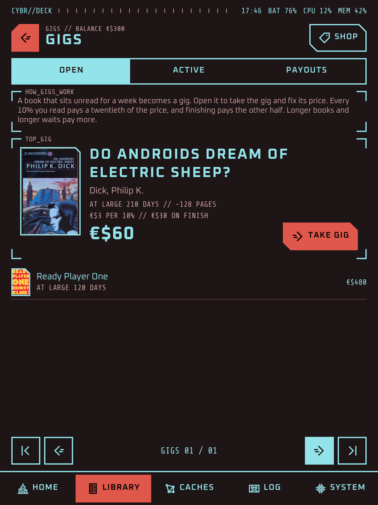
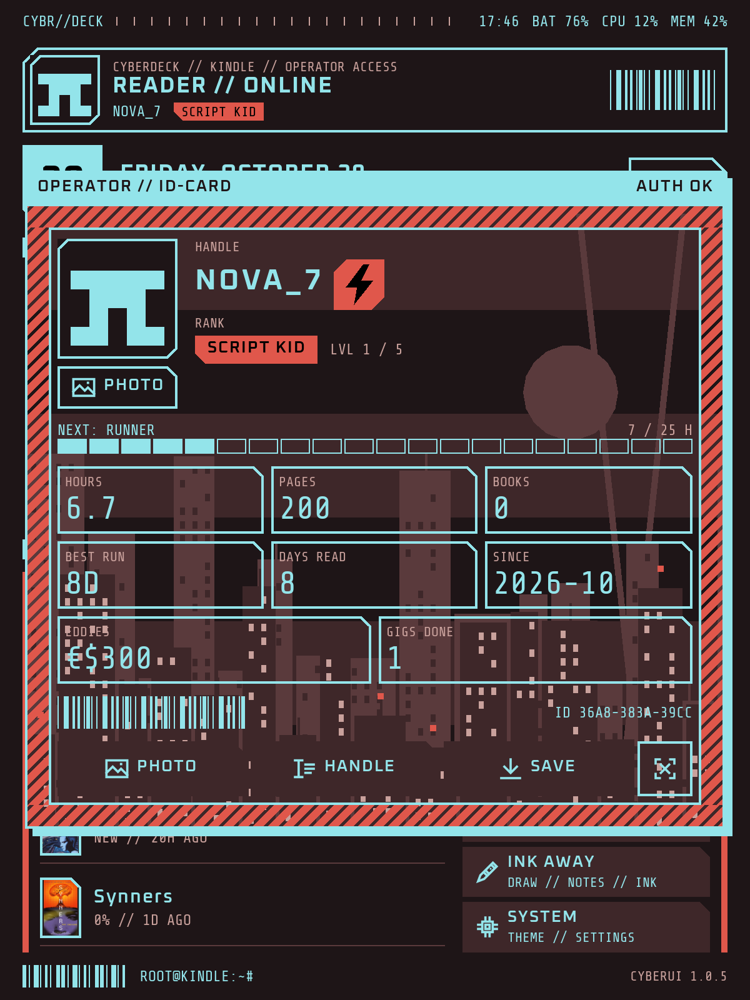

 

[&color=rgb(147%2C228%2C234))](https://github.com/EmirErtorer/CyberUI.koplugin/releases/latest)
[&color=rgb(147%2C228%2C234))](https://github.com/EmirErtorer/CyberUI.koplugin/releases)
[&color=rgb(147%2C228%2C234))](CHANGELOG.md)
[&color=rgb(147%2C228%2C234))](https://buymeacoffee.com/emirertorer)

CyberUI is a **cyberpunk home screen** for KOReader, built to be fast on e-ink. Home comes back the moment you close a book, in a single screen refresh.

* **A home that feels like a deck**: the book you are reading, recent books, your streak and a launcher, with live readouts.
* **A library you can work in**: folders, ASCII covers, search, collections, a reading log and a trash, with rename, move and delete that keep your reading data.
* **A reason to read the backlog**: an operator ID card, Gigs that pay eddies for books you never opened, and a shop where eddies buy new looks.
* **Your look**: seven colour schemes and your own, fourteen font sets, ASCII covers and sleep screens, KOReader's menu restyled to match, and ten languages.

## Install

Unzip the download and copy the `CyberUI.koplugin` folder into KOReader's `plugins` directory, then restart KOReader:

- Kindle: `koreader/plugins/`
- Kobo: `.adds/koreader/plugins/`
- Android: `koreader/plugins/` in app storage

Then open the top menu, the first tab (the file browser's), **Start with**, **CyberUI**. After that it can update itself: System, About, Updates.

## Start

1. **Open a book** from Resume, a recent book or the library. Close it and you are back home.
2. **Swipe down from the top** for KOReader's menu in CyberUI's style. The Deck tab has your operator ID and the controls.
3. **Hold things.** Books, folders, collections, the banner and the progress bar all have more on a long press.

For a gesture that goes home from a book, open a book first, then Settings, Taps and gestures, Gesture manager, and pick "CyberUI home" under General. Everything else is in System: colour scheme, fonts, covers, the banner and the status bar.

<table>
  <tr>
    <td width="33%" valign="top"> Home: the book you are reading, a recovered highlight, recent books and a launcher.</td>
    <td width="33%" valign="top"> Gigs: books you never opened become paid work.</td>
    <td width="33%" valign="top"> Your operator ID card, with your eddies and a look from the shop.</td>
  </tr>
  <tr>
    <td width="33%" valign="top"> The library, with ASCII covers, filters and sort.</td>
    <td width="33%" valign="top"> The reading log: streaks, a calendar and your goal.</td>
    <td width="33%" valign="top"> Diagnostics, over a see-through view of the board.</td>
  </tr>
  <tr>
    <td width="33%" valign="top"> Seven colour schemes and your own.</td>
    <td width="33%" valign="top"> The shop: twenty looks for eddies.</td>
    <td width="33%" valign="top"> KOReader's menu, restyled: the operator ID and the controls in the Deck tab.</td>
  </tr>
</table>

## What's inside

* **Home:** the active book with Resume, a banner, a status bar of readouts, progress styles, diagnostics and an editable launcher.
* **Library:** folders, grid or list, filters, search, collections, a 30-day trash and a reading log.
* **Operator, gigs and shop:** an ID card with a rank from your reading hours, Gigs for books left unread, eddies in a signed ledger, twenty looks to spend them on, and your highlights as data shards.
* **Look:** colour schemes, fonts, ASCII covers and sleep screens, icons of its own and ten languages.
* **KOReader's menu:** restyled over home and inside books, with a Deck of controls, and an Annotate button when [Ink Away](https://github.com/EmirErtorer/ink-away.koplugin) is installed.

The full list, with every setting and more screenshots, is in [docs/FEATURES.md](docs/FEATURES.md). What changed in each version is in the [changelog](CHANGELOG.md).

## Notes

- Tested on KOReader 2026.07.1 and newer, on a Kindle Paperwhite, a Kindle Scribe and an Android tablet.
- CyberUI only reads your library to show it. It changes files only when you rename, move or delete something, and deleted things wait in its trash for 30 days.

## How it's made

I design CyberUI and test it on my Kindle Paperwhite. Every screen paints in milliseconds and nothing redraws more than it needs to. Every change runs against CyberUI's checks on KOReader's own drawing code and in the emulator, and anything I can't test there goes out as a prerelease first.

## Contributing

Bug reports, testing prereleases on your reader, colour schemes, translations, ideas and pull requests are all welcome. [CONTRIBUTING.md](CONTRIBUTING.md) explains how to get started, and [SECURITY.md](SECURITY.md) how to report a security problem.

## License

MIT (see [`LICENSE`](LICENSE)). The bundled fonts are under the SIL Open Font License; see [NOTICE.md](NOTICE.md).
