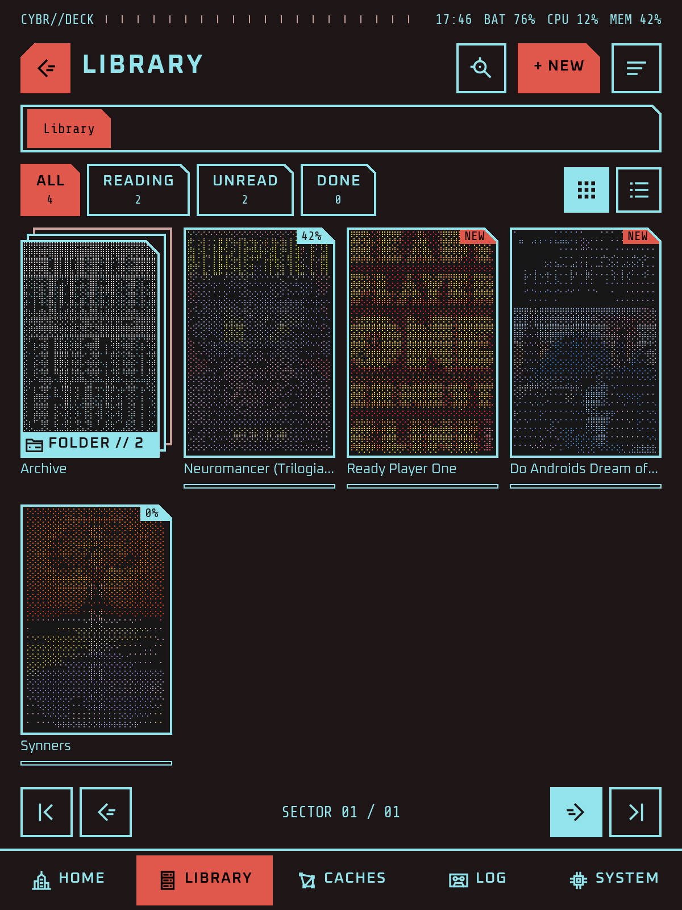
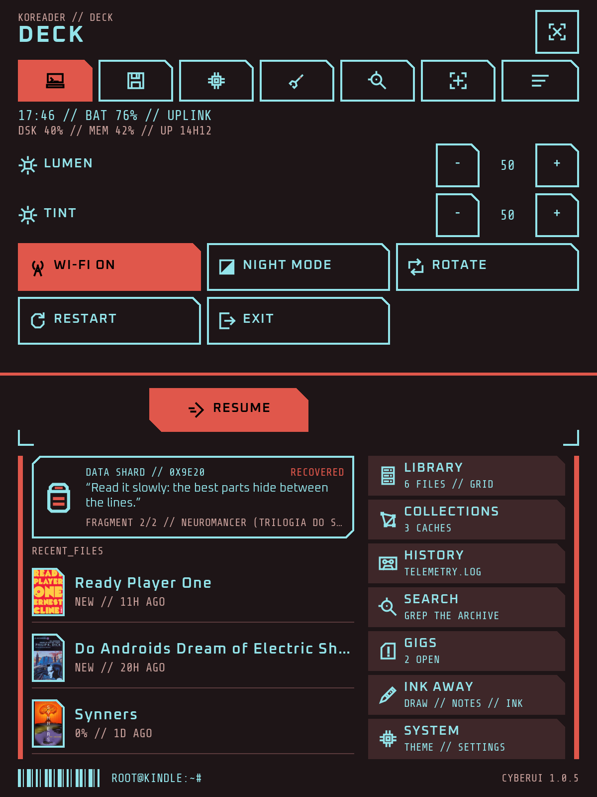
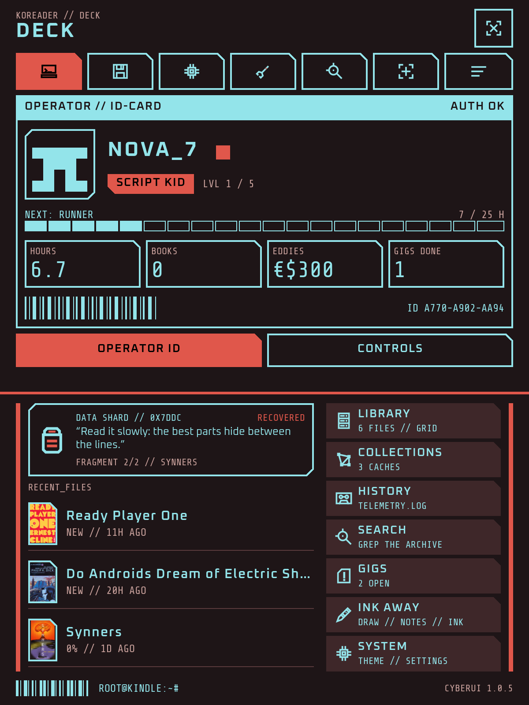
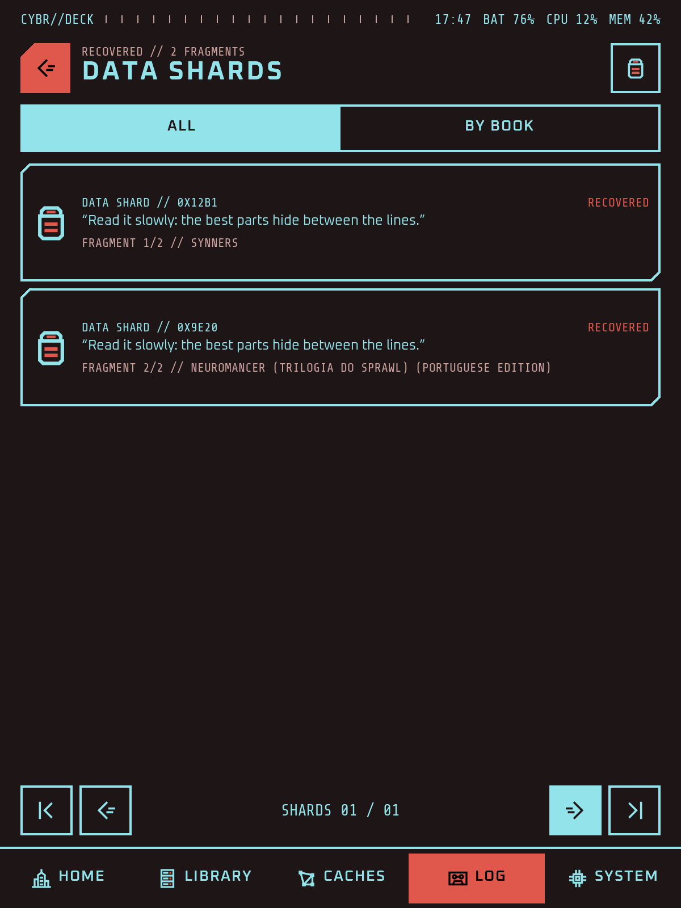
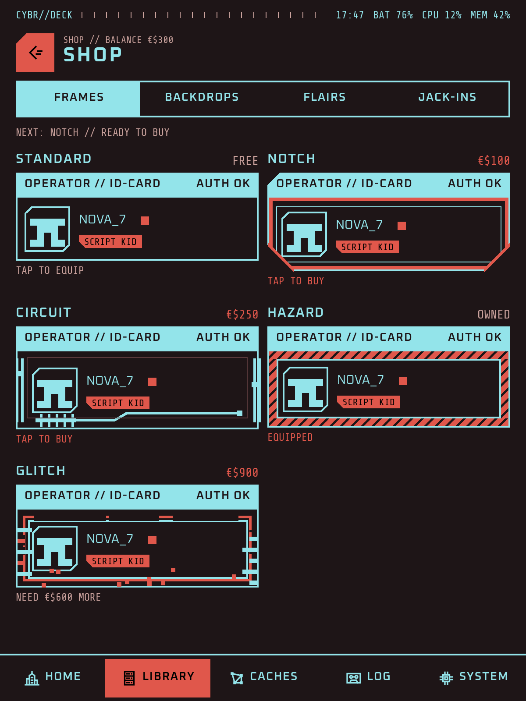
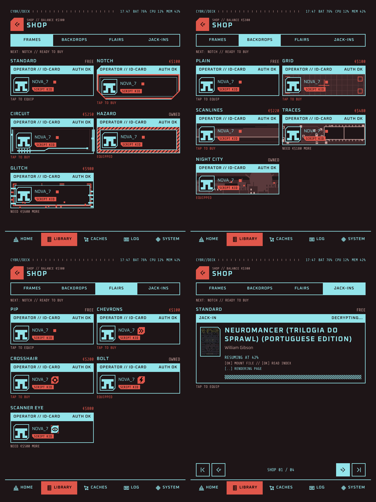
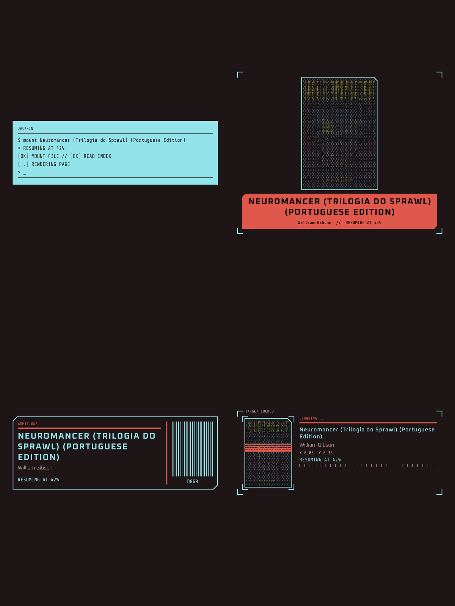
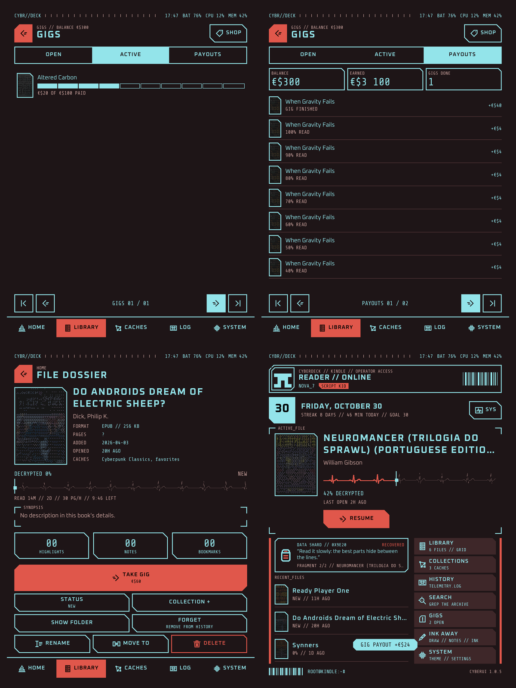
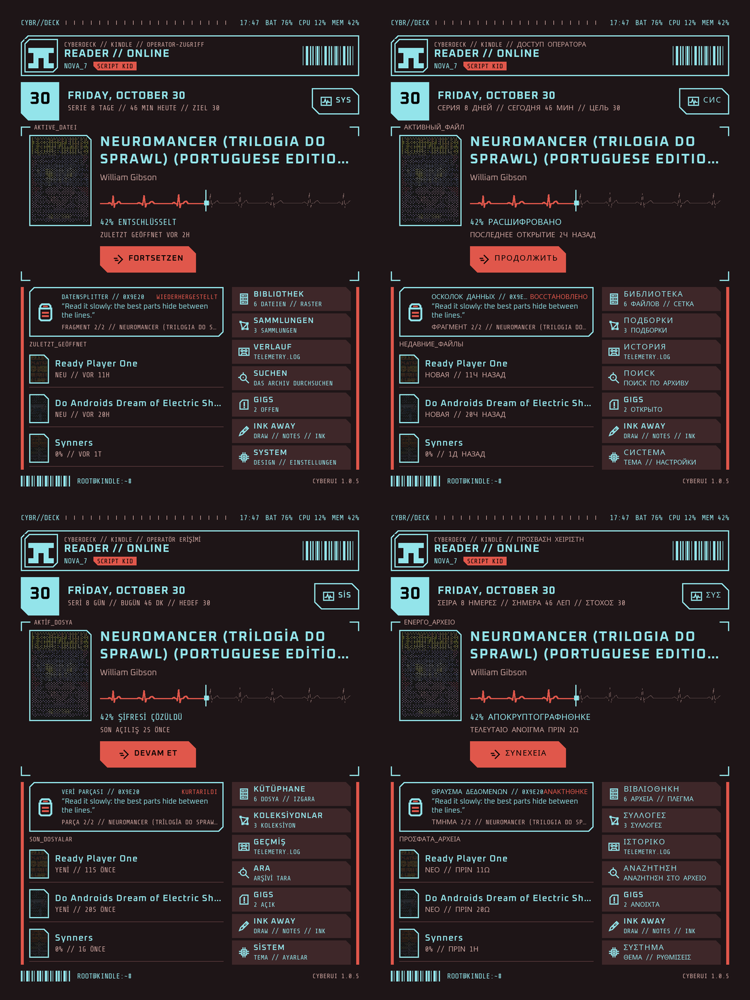
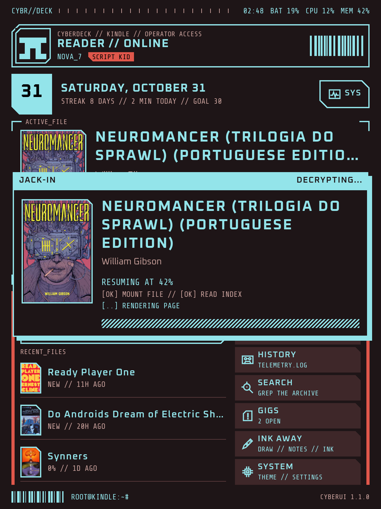

# CyberUI features

The full list, with every setting. The [README](../README.md) has the short version, and [CHANGELOG.md](../CHANGELOG.md) what changed in each version.

## Home

| | |
|---|---|
| **Active file** | The book you are reading, with its cover, progress and Resume. Tap a recent book to bring it here; open it from the panel. |
| **Back from a book** | Home shows at once and the book stays open underneath, so coming home and resuming the same book are instant (System, Speed, on by default); KOReader closes it later. KOReader's own Home action takes the same way while CyberUI is your home, and the "CyberUI home" action goes on any gesture. |
| **Banner** | A set line, a greeting with your handle, a random highlight from your books, the device's status or your own words, with a top line of its own. Hold it to change it. |
| **Status bar** | Your tag, then up to six readouts in the order you choose: clock, date, battery, Wi-Fi, frontlight, processor, memory, storage, book progress, uptime. |
| **Progress** | Segments, an ASCII bar, a heartbeat trace, a scan line or an equalizer, each marking exactly where you are. Hold the bar to switch. |
| **Diagnostics** | Battery and drain, processor and memory, storage, Wi-Fi, screen and light, uptime and the device at a glance, behind the SYS button. |

## Operator, gigs and shop

| | |
|---|---|
| **Operator ID card** | A handle, a rank earned from your reading hours, an ID code and barcode, your totals and a photo from the device. Tap your face on home to open it; save it as a picture. |
| **Gigs** | A book left unread for a week becomes a gig. Opening it takes the gig and fixes the price (about a fifth of an eddy per page, up to double for long waits). Every 10% you read pays a twentieth of it, and finishing pays the other half. Home tells you what each reading paid. |
| **Eddies** | Earned only by reading gigs. They sit in a signed ledger, so editing the settings file does not add any, and your balance shows on the ID card. |
| **Shop** | Spend eddies on looks, never anything else: card frames, backdrops, handle flairs and jack-in cards, five of each with one free. Every style is previewed before you buy. |
| **Data shards** | Your highlights as recovered fragments on home and in their own screen; open the book at the highlight. |

## Library

| | |
|---|---|
| **Browse** | Folders with breadcrumbs, a grid or a list, sort by recent, title, author or added, and filters for reading, unread and done. Folders show as a stack under their first book's cover. |
| **Book actions** | Hold a book or folder to open, see details, mark it done, add it to collections, rename, move or delete it. Rename and move keep its reading data, history and collections. |
| **Trash** | Deleted books and folders wait 30 days and go back exactly where they were. |
| **Details** | Facts, progress, a synopsis that pages, and highlight, note and bookmark counts. |
| **Search** | Titles, authors and file names as you type, on CyberUI's own keyboard. |
| **Collections and log** | KOReader's collections as fans of covers (hold one to delete it), and your reading log by day and session. |

## Look

| | |
|---|---|
| **Colour schemes** | Mono, Graphite, Neon, Synthwave, Bloodline, Terminal and Amber, or your own two colours, each in light and dark and following KOReader's night mode. Greyscale screens get the grey ones. |
| **Fonts** | Fourteen sets, from Oxanium (the default) and Orbitron to the VT323 terminal and Press Start 2P arcade, or any font installed on your reader, with a text size of your own. |
| **ASCII covers** | Covers drawn as character art, in colour on colour screens, in Braille, Classic, Detailed, Blocks, Binary, Hex, Glitch or your book's own title. Image covers and title cards too, in four sizes. |
| **ASCII sleep screen** | KOReader's sleep screen redrawn in ASCII: book covers by default, or custom images, or everything. Transparent pictures let your book or home show through, and KOReader's message stays crisp. |
| **Icons** | A set of its own, drawn for CyberUI, with small lights in your accent colour. |
| **Languages** | Turkish, Brazilian and European Portuguese, Spanish, Italian, French, German, Russian, Polish and Greek, following KOReader's language. Translations are plain `.po` files in `l10n`, so a fix needs no code. |

## KOReader's menu

| | |
|---|---|
| **Restyled** | The drop-down menu over home and inside books, in CyberUI's style, read live from KOReader so every setting and every plugin's entry is there. It drops from the top and takes up to half the screen. |
| **Deck** | Two pages: your operator ID, and the controls (frontlight and warmth, Wi-Fi, night mode, rotate, Annotate, restart and exit, with the device at a glance). In a book too, in the order you choose. |
| **Annotate** | When Ink Away is installed: a tile in the Deck's controls and an entry in the reader's Tools menu open its annotation mode on the book. |
| **With ZenOS** | When ZenOS is running, its Controls and Launcher show as CyberUI tiles instead of the Deck. |

## Speed and e-ink

| | |
|---|---|
| **Fast** | Home paints in a few milliseconds, covers are drawn once and cached, and the reader's code loads while home sits idle, so even your first book opens quicker. |
| **Refreshes** | Only what changed is redrawn. Values that keep changing never refresh the screen by themselves, and dark screens get the cleaner refreshes they need. |

## Companions and updates

| | |
|---|---|
| **Ink Away** | On the launcher: it opens when installed, and otherwise installs from GitHub in one tap. |
| **Updates** | System, About, Updates shows the newest release (and prereleases, if you want them) with its notes, and installs it after checking the download. Once a day, only on Wi-Fi that is already on, it looks by itself and says so on home. |

## Screenshots

<table>
  <tr>
    <td width="33%" valign="top"> The library: ASCII covers, folders stacked under their first book, filters and sort.</td>
    <td width="33%" valign="top"> KOReader's own menu, restyled: every setting and plugin, with the controls in the Deck tab.</td>
    <td width="33%" valign="top"> The Deck tab's other page: your operator ID with eddies and totals, a swipe from the controls.</td>
  </tr>
  <tr>
    <td width="33%" valign="top"> Collections, each a fan of its books.</td>
    <td width="33%" valign="top"> The reading log: your week, streaks, a calendar that can be a city skyline, and your goal.</td>
    <td width="33%" valign="top"> Diagnostics: battery, processor, memory, storage, Wi-Fi and screen, over a see-through view of the board.</td>
  </tr>
  <tr>
    <td width="33%" valign="top"> Seven colour schemes and your own, in light and dark.</td>
    <td width="33%" valign="top"> Covers as ASCII art in eight character sets, as pictures or as title cards.</td>
    <td width="33%" valign="top"> The sleep screen in ASCII: your book's cover, a picture, or anything KOReader shows.</td>
  </tr>
  <tr>
    <td width="33%" valign="top"> Data shards: every highlight you made, recovered as a fragment.</td>
    <td width="33%" valign="top"> The shop: five styles to a category, each shown as it really looks, with its price.</td>
    <td width="33%" valign="top"> Twenty styles: card frames, backdrops, handle flairs and jack-in cards.</td>
  </tr>
  <tr>
    <td width="33%" valign="top"> Jack-in cards, shown while a book opens.</td>
    <td width="33%" valign="top"> Take a gig, read, get paid as you go, and see it on home.</td>
    <td width="33%" valign="top"> Ten languages: Turkish, Portuguese (both), Spanish, Italian, French, German, Russian, Polish and Greek.</td>
  </tr>
  <tr>
    <td width="33%" valign="top"> The default jack-in card, over home while a book opens.</td>
  </tr>
</table>
